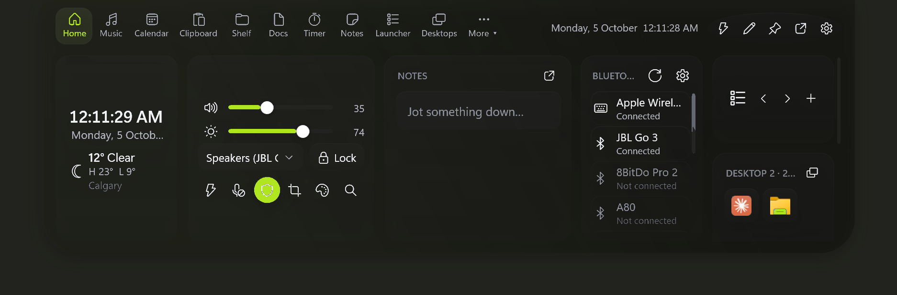
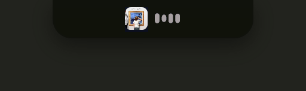
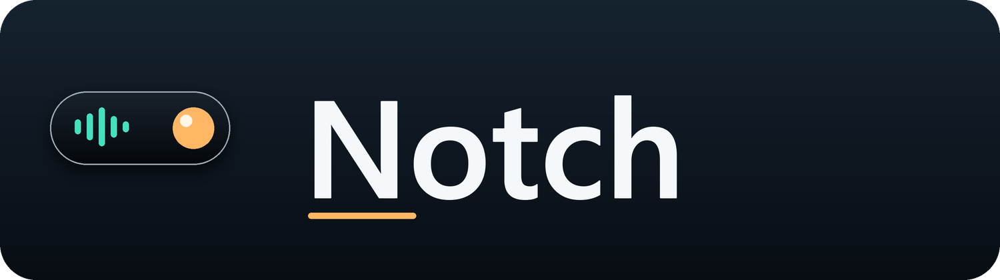
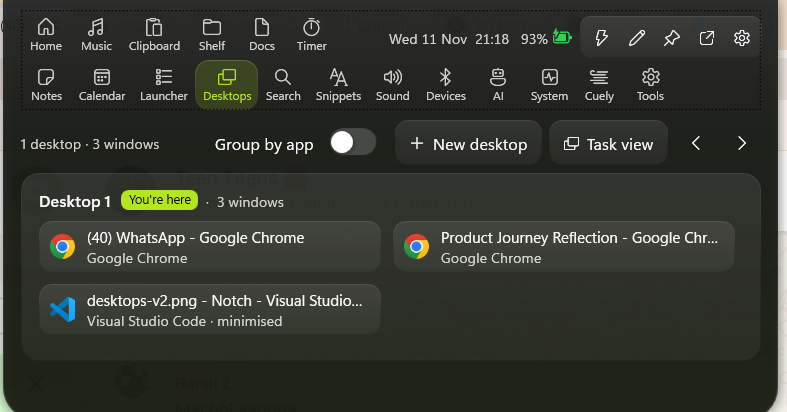
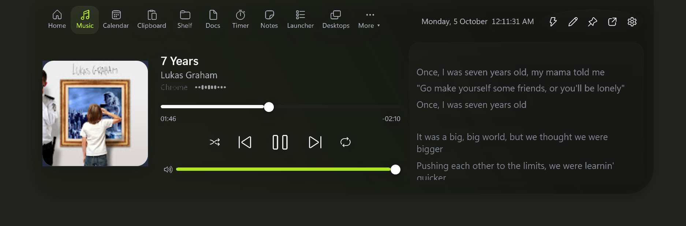
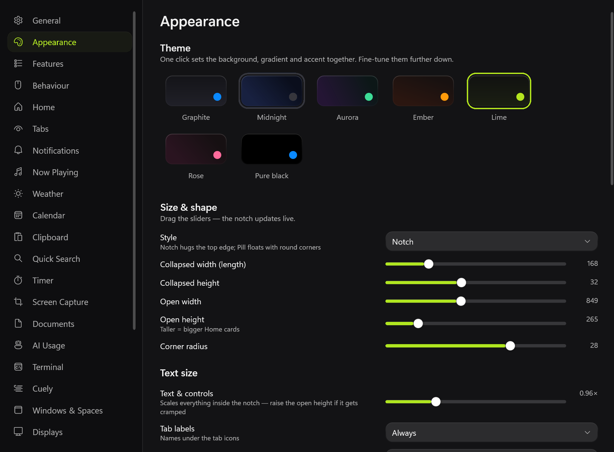

<p align="center">
  
</p>

<p align="center">
  A modern notch-style utility for Windows, inspired by the experience of using a similar app on macOS and extended with features built specifically for Windows.
</p>

<p align="center">
  
  
</p>

<p align="center">
  
</p>

I couldn't find a close equivalent for Windows, so I built one myself. The project combines the idea that inspired me with my own functionality, with a simple goal: make everyday desktop tasks a little faster and easier.

## Contents

- [Why I built this](#why-i-built-this)
- [Features](#features)
- [Download and install](#download-and-install)
- [First launch and controls](#first-launch-and-controls)
- [Settings guide](#settings-guide)
- [Home cards](#home-cards)
- [Privacy and data](#privacy-and-data)
- [Build from source](#build-from-source)
- [Project layout](#project-layout)
- [Troubleshooting](#troubleshooting)
- [Documentation](#documentation)
- [Roadmap](#roadmap)
- [Credits and licence](#credits)

## Why I Built This

I really enjoy building small tools that make everyday tasks simpler and save a little time.

I came across a macOS app that used the notch in a really clever and useful way, and I really liked the experience. When I looked for something similar on Windows, I couldn't find an app that offered the same kind of experience.

So I decided to build one myself.

This project brings a similar notch-style experience to Windows, while also adding functionality of my own that goes beyond the original inspiration. The goal is to make the Windows desktop a little more useful, interactive, and convenient without adding unnecessary complexity.

This project was **inspired by [Notch](https://notchy.dev) for macOS**, but it is independently developed for Windows with its own implementation and additional features.

## Features

### The notch

<p align="center">
  
</p>

- **Works on any Windows 10/11 PC** — a small black pill at the top of the screen, notch or no notch.
- **Hover or click to open**; it closes on its own when the mouse leaves. Every gesture can be switched off.
- **Live activities, side by side** — music, a running timer, downloads, your latest note, the terminal, builds — ranked so the most important comes first.
- **Islands** — short pop-ups for whatever just happened, with buttons where useful (Open, Show in folder, Snooze, Allow…).
- **Peek on hover** — mini play / pause controls without opening the panel.
- **Choose which tab opens** — a fixed tab, the last one you used, or "smart" (music while something plays, the timer while it runs).
- **Right-click menu** — default tab, edit layout, settings.
- **Gestures** — scroll or two-finger swipe to switch tabs, scroll on the closed pill to change volume, `Ctrl+1–9` for tabs.
- **Pop out any tab** into its own floating window — always on top, or pinned to the desktop like a widget.
- **Hidden from screen capture** with one switch — invisible in OBS, Zoom, Teams and screenshots.
- **Hides while a game or video is fullscreen.**
- **Any display** — choose the monitor, notch or floating-pill style, and an offset below a taskbar or bezel.

### Make it yours
- **Size & shape** — width and height (closed and open), corner radius.
- **Themes** — Graphite, Midnight, Aurora, Ember, Lime, Rose or Pure black in one click; everything stays adjustable.
- **Colours** — solid black, any colour, a gradient, or your own picture; accent colour, and a separate tab-highlight colour and strength.
- **Frosted glass** — optional live blur of what's behind the open notch, with tint and a sheen-and-rim highlight.
- **Text size** — scale everything inside the notch.
- **Animations** — springy open / close, adjustable speed, or off.
- **Tabs** — named icons; show, hide and reorder them (in the notch or in Settings); tabs that don't fit go on a second row or into a **More ▾** menu; turn any feature off completely.
- **Clock** — 12- or 24-hour, seconds, AM/PM and date style.
- **Your own icons** — give any Launcher or Shelf item a custom picture.
- **Settings** — 26 pages, every change previews live, and everything is also in a plain `settings.json` you can edit.

### A Home page you design
- **22 cards** — clock, weather, world clocks, Now Playing, volume & output, brightness, quick toggles, sound & brightness (all-in-one), Bluetooth, battery, reminders, calendar, notes, clipboard, shelf, camera, screen time, Spaces (virtual desktops), open windows, timer, system stats and apps.
- **Arrange them in the notch** — click ✎, then **+ Add card**; move, resize (width and height), remove or drag cards onto each other.
- **Or in Settings › Home** — with a live preview of the layout.
- Cards sit on a 12-column grid; short cards slide in under tall ones, and extra rows scroll.

### Music & sound
- **Now Playing** — Spotify, YouTube Music / YouTube in any browser, Apple Music, Media Player and anything else in Windows' media controls.
- Album art, scrubbing, shuffle, repeat, per-app volume, and playback speed for browser videos. Click the album art to jump to the app that's playing.
- **Live audio spectrum** — real analysis of what you hear, in the tab and optionally on the pill.
- **Synced lyrics** (LRCLIB), in the tab or line-by-line on the pill.
- **Sound mixer** — volume and mute per app, without touching the system volume.
- **Output switcher** — speakers ⇄ headphones in one click (also from the command palette), with an island when it changes.
- **One-click microphone mute** — silences every mic at once, so Zoom, Meet and Teams all go quiet.

### Productivity
- **Clipboard history** — text, images and files; pins that survive clearing; search, including text *inside* images (on-device OCR).
- **Smart clipboard actions** — open links, compose emails, colour swatches, and paste straight back into the app you were using. Password managers are never recorded.
- **File shelf** — drop files on the notch, drag them out anywhere later; survives restarts. Zip, unzip, and convert images (PNG, JPEG, TIFF, BMP, GIF, HEIC, PDF → images) offline.
- **Quick notes** — the newest open note rides on the pill until you tick it off.
- **Reminders in plain words** — "Call Sam tomorrow 9am", "Stretch in 20m"; snooze or mark done from the island.
- **Calendar** — Google, Outlook / Exchange and iCloud through their private iCal links (no sign-in), with alerts and Zoom / Meet / Teams **Join** buttons.
- **Pomodoro timer** — focus / break chaining, countdowns, a drift-free stopwatch, streaks, a 7-day chart, and a mascot on the pill 🐢 🐇 🐱 🦊 🐧 🚀 🍅.
- **Command palette** (`Ctrl+Shift+Space`) — every tab and action, inline maths, web search, snippets.
- **Search & translate** — 9 search engines plus your own, live translation, a calculator with history, and saving a video from a link (with yt-dlp).
- **Text snippets** — paste saved text with `{date}`, `{time}` and `{clipboard}` placeholders; your clipboard is restored afterwards.
- **App launcher** — pin your apps, pick from the Start menu or drop shortcuts in, drag to reorder, run as administrator.
- **Cuely teleprompter** — your script scrolls right under the webcam during calls; speed, size and mirror.
- **Camera mirror** — check yourself before a call; nothing is recorded.

### Documents & PDF
- **Word → PDF** — also Excel, PowerPoint, OpenDocument, RTF and text files.
- **PDF → Word** — an editable `.docx`.
- **PDF editor** — reorder pages (drag or move), rotate, delete, merge other PDFs, extract selected pages, split into single pages.
- **Add to a PDF** — text at the top or bottom, a diagonal watermark, page numbers, and a password.
- Originals are never overwritten; results appear under **Recent**, ready to drag anywhere.

<p align="center">
  
</p>

### Screen capture
- **Drag a box** — the screen freezes, you select, and the shot is **copied to the clipboard**. Works on every monitor; `Enter` takes the whole screen.
- Also put it on the shelf and / or save it to a folder; a preview island you can drag into any app; an optional keyboard shortcut.
- Or use Windows' Snipping Tool instead.
- **Colour eyedropper** — a magnifier follows the cursor; click to copy the hex code.

### System & devices
- **Volume, brightness and Caps Lock HUDs** — as an island, a bar on the screen edge, or a round gauge, at any size. Can replace the Windows volume pop-up.
- **Brightness** — built-in screens, and external monitors over DDC/CI.
- **Bluetooth** — paired devices, connected or not, with battery for mice, keyboards and headphones; one click to Windows' quick connect.
- **AirPods** — battery for each bud and the case when the case opens nearby.
- **Battery** — charging / unplugged islands, a "fully charged" reminder (80–100%), and a low-battery alert with sound.
- **Caffeine (keep awake)** — on, for 30 min / 1 h / 3 h, or until a time; screen on or off; turns itself off on low battery. Middle-click the tray icon to toggle.
- **Download alerts** — from any browser, no extension; open, show in folder or put on the shelf.
- **USB drives** — an island when one is plugged in, with **Eject** and "safe to remove".
- **Screenshots** — Win+PrtScn and Snipping Tool saves are staged on the shelf.
- **Privacy dot** — green while the camera is in use, orange for the microphone.
- **Notifications from other apps** — WhatsApp, Teams, Outlook and the rest slide out of the notch, with an unread count on the pill and a Notifications tab; mute apps or hide message text (Microsoft Store version).
- **Do Not Disturb** — follows Windows Focus; low-priority islands stay quiet.
- **Screen time** — today's time on the PC and your top apps; idle time and the lock screen don't count.
- **Spaces** — see which virtual desktop you're on, switch, add one or open Task view; an island names the desktop when you switch.
- **Desktops tab** — every virtual desktop with the apps and windows open on it. Click to jump to a window, drag windows (or a Ctrl+click selection) onto another desktop to move them, or minimise and close them from the list.
- **Weather & world clocks** — search for any city as you type, keep a list of places, and see each one's time, how far ahead or behind it is, and its weather.
- **Window snapping** — drag a window to the notch and drop it on a layout zone (optional).
- **Terminal** — a drop-down Windows Terminal from the top edge (or a normal window), with show, hide and close.
- **System stats** — CPU, memory, network and disk with live graphs.
- **Lock screen** in one click, **keyboard cleaning lock** (60 s, `Ctrl+Esc` unlocks) and a **keystroke HUD** for presentations (password fields are never shown).
- **Permissions page** — see at a glance whether camera, microphone and location are allowed, with links to fix them.

<p align="center">
  
</p>

### For developers
- **Local API** — `127.0.0.1` only, token-protected, off by default; scripts, CI and shells can show their own islands.
- **Claude Code approvals** — when Claude Code asks for permission, click **Allow** or **Deny** in the notch.
- **Agent activity** — Claude Code turns with per-turn cost, and Codex turn-complete islands.
- **AI usage** — Claude Code and Codex from local logs (5-hour windows, tokens, cost, rate limits) and GitHub Copilot quota, with alerts before you hit a limit.
- **Shell activity** — long PowerShell commands become live islands, with a ✓ or ✗ when they finish.

<p align="center">
  
  
</p>

## Download and install

Notch supports **Windows 10 version 2004 (build 19041) or later, and Windows 11**. Choose the build that matches your processor:

- `Notch-win-x64.zip` — Intel and AMD PCs.
- `Notch-win-arm64.zip` — Windows on ARM.

Download the ZIP from a published project release, extract it, and run `Notch.exe`. The ZIP build is self-contained: it does not need a separate .NET runtime, an installer, or administrator access. To start Notch automatically when you sign in, enable **Settings › General › Start Notch with Windows**.

Notch is not currently code-signed, so Windows SmartScreen may show a warning. Only run it if you trust the source you downloaded it from.

### Optional components

- **Microsoft Word or LibreOffice** — document conversions use Word when available, or LibreOffice as an alternative. Install [LibreOffice](https://www.libreoffice.org/download/download-libreoffice/) for conversions when Word is not installed.
- **yt-dlp** — optional video downloads from a link. Install it separately if you use that feature; the path can be configured in **Settings › Quick Search**.
- **A GitHub token** — optional, and only needed to display your GitHub Copilot quota in **AI Usage**.
- **Calendar feed links** — optional `.ics` URLs that you provide yourself; Notch does not sign in to your calendar account.
- **DDC/CI support** — required for brightness control on compatible external monitors. Enable DDC/CI in the monitor's on-screen menu if needed.

### Where your data lives

- The unpackaged ZIP build stores settings and app data in `%APPDATA%\Notch`.
- The Microsoft Store build uses Windows-managed, package-specific app data. Windows removes that package data when the Store app is uninstalled.
- Settings are saved in `settings.json`; feature data is stored locally. The Copilot token, if configured, is protected with Windows DPAPI.

On first launch, if `%APPDATA%\Notch` does not already exist, Notch checks for older `NotchX` or `Notchify` data folders and copies their data forward. More detail is in the [privacy policy](docs/PRIVACY.md).

## First launch and controls

| Do this | To |
|---|---|
| Hover over or click the pill | Open the panel (if hover-to-open is enabled) |
| `Ctrl+Shift+N` | Open or close the notch |
| `Ctrl+Shift+Space` | Open the command palette |
| `Ctrl+1` … `Ctrl+9` | Switch to a visible tab by its order |
| Scroll over the tab bar | Switch tabs (when enabled) |
| Scroll over the closed pill | Change volume (when enabled) |
| ✎ in the header | Arrange tabs and Home cards |
| Right-click the notch | Open the quick menu for layout, default tab, and settings |
| Drag files onto the pill | Add files to the Shelf |
| `Enter` during built-in screen capture | Capture the entire screen |
| `Esc` during built-in screen capture | Cancel the capture |
| Left-click the tray icon | Open or close the notch |
| Middle-click the tray icon | Toggle Caffeine (keep awake) |
| Right-click the tray icon | Open the tray menu, including **Quit Notch** |

The global hotkeys and gestures can be changed in **Settings › General** and **Settings › Behaviour**. Closing the panel only hides it; choose **Quit Notch** in Settings or the tray menu to exit the app.

## Settings guide

Settings are grouped by page. Most changes apply immediately and are saved automatically.

| Page | What it controls |
|---|---|
| **General** | Windows startup, global shortcuts, screen-time tracking, and shortcuts to the data folder and settings file. |
| **Appearance** | Themes, colors, background, size and shape, text scale, tab labels and overflow, glass effects, clock, and animation. |
| **Features** | Enable or disable modules. Disabling a feature stops its tab and background work. |
| **Behaviour** | Default tab, hover and peek behavior, auto-collapse, gestures, fullscreen hiding, and screen-capture privacy. |
| **Home** | Preview, add, remove, resize, and arrange Home cards on the 12-column grid. |
| **Tabs** | Show or hide tabs, change their order, and open a tab in a detached window. Hidden tabs can keep running in the background. |
| **Notifications** | Notification mirroring, message privacy, muted apps, system HUDs, download and device alerts, and Do Not Disturb behavior. Mirroring other apps' notifications requires the Store package. |
| **Now Playing** | Music on the closed pill, the audio spectrum, and synced lyrics. |
| **Weather** | Saved cities, the main location, units, and update behavior. |
| **Calendar** | User-provided iCalendar feed URLs, event alerts, refresh interval, and reminders. |
| **Clipboard** | History size, image capture and OCR, auto-paste, excluded apps, and clearing history. Pinned items survive a history clear. |
| **Quick Search** | Default and custom search engines, translation provider and language, and the optional video downloader. |
| **Timer** | Focus and break lengths, automatic session chaining, end sounds, and the timer mascot. |
| **Screen Capture** | Capture method, clipboard and Shelf behavior, save folder, preview island, shortcut, and Windows screenshot monitoring. |
| **Documents** | Word/LibreOffice converter selection, output location, and whether to open or shelve results. |
| **AI Usage** | Claude Code and Codex log locations, Copilot token, usage sections, budgets, alerts, and closed-pill indicators. |
| **Terminal** | Show or hide Windows Terminal and choose drop-down or normal-window mode. |
| **Cuely** | Teleprompter speed, text size, and mirroring. |
| **Windows & Spaces** | Window snapping and virtual-desktop actions. |
| **Displays** | Target display, top offset, fullscreen behavior, and external-monitor brightness. |
| **Battery** | Charging, full-charge and low-battery alerts, and low-battery sound. |
| **Connectivity** | Bluetooth/AirPods alerts, audio-output alerts, and USB drive alerts. |
| **Caffeine** | Keep the PC awake indefinitely or for a duration, keep the display on, and low-battery auto-off. |
| **Permissions** | A status overview and Windows Settings links for camera, microphone, location, startup, and related features. |
| **Developer** | The opt-in local API, token, Claude Code hooks, agent activity, shell activity, and log access. |
| **About** | Version, credits, data folder, and log. |
| **Quit Notch** | Exit the app or restart it. |

## Home cards

Home is a customizable dashboard. Click **✎**, choose **+ Add card**, then drag, resize, or remove cards. You can also arrange cards in **Settings › Home**.

| Card | What it shows or does |
|---|---|
| **Clock** | Current time and date, plus today's weather. |
| **Weather** | Temperature, conditions, and today's high and low for the main saved place. |
| **World clocks** | Time, weather, and time difference for each saved place. |
| **Now Playing** | Album art, track details, and playback controls for Windows media sessions. |
| **Volume & output** | Master volume, mute, and audio-output selection. |
| **Brightness** | Built-in display brightness, with DDC/CI support for compatible external monitors. |
| **Quick toggles** | Shortcuts for Caffeine, microphone mute, screen capture, the eyedropper, command palette, and screen lock. |
| **Sound & brightness** | Combined volume, brightness, output, lock, and quick-toggle controls. |
| **Bluetooth** | Paired devices and reported battery levels. Windows Quick Settings handles audio-device connection. |
| **Battery** | This PC's battery and reported batteries for Bluetooth devices. |
| **Reminders** | Upcoming reminders with completion controls. |
| **Calendar** | Events from the calendar feeds you configured. |
| **Notes** | Quick notes; the newest open note can also appear on the pill. |
| **Clipboard** | Recent clipboard items and pinned entries. |
| **Shelf** | Files staged for quick access and drag-and-drop. |
| **Camera** | Local camera preview; the preview is not recorded. |
| **Screen time** | Today's active time and top apps, stored on this PC. |
| **Spaces** | Current virtual desktop, with actions to switch or add desktops. |
| **Open windows** | Windows on the current desktop; click one to switch to it. |
| **Timer** | Pomodoro focus/break timer and stopwatch. |
| **System** | CPU, memory, and network information. |
| **Apps** | Your pinned apps from the Launcher. |

Cards use a **12-column grid**. Width is measured in columns; height is measured in rows. Short cards can share a row beneath taller cards, and additional rows scroll.

## Privacy and data

Notch has no account system, advertising, analytics, or telemetry. Most features work locally. Network access is used only by features that need it:

| Feature | Destination | When it connects |
|---|---|---|
| Weather and city search | Open-Meteo | To update saved places or search for a city. |
| Synced lyrics | LRCLIB | When lyrics are enabled for a playing track. |
| Calendar | The `.ics` URLs you enter | To refresh the feeds you configured. |
| Translation | Google Translate or your chosen LibreTranslate server | When you request a translation. |
| Copilot quota | GitHub API | Only when you add a token and enable the integration. |
| Web search | The search engine opened by your browser | When you submit a search. |
| Video downloads | The video site contacted by yt-dlp using the URL you provide | Only when you use the downloader. |

Clipboard history, notes, reminders, screen time, AI-tool usage logs, and document processing stay on your PC. Clipboard capture can be disabled; password-manager sensitive-content markers are respected, and apps can be excluded. Optional camera preview is local and is not recorded. The developer API is off by default, listens on `127.0.0.1` only, and requires its per-install token.

Some features access local Windows state to work—for example, media sessions, audio devices, window titles, Bluetooth battery reports, or camera/microphone usage indicators. Other-app notification mirroring is available only in the Microsoft Store package and requires Windows permission. See the [full privacy policy](docs/PRIVACY.md) for what each feature reads and stores.

## Build from source

### Requirements

- Windows 10 version 2004 (build 19041) or later, or Windows 11.
- The **.NET 8 SDK**.
- PowerShell for the helper scripts.

From the repository root in PowerShell:

```powershell
.\build.ps1
```

`build.ps1` runs the Debug build and launches Notch. If the .NET SDK is missing, it attempts to install .NET 8 through WinGet. To run directly with the SDK:

```powershell
dotnet run --project src\Notchify\Notchify.csproj
```

Build without launching:

```powershell
dotnet build src\Notchify\Notchify.csproj -c Release
```

Publish a self-contained, single-file executable for the current machine's architecture:

```powershell
.\build.ps1 -Publish
```

The executable is written to `publish\Notch.exe`. To publish both x64 and ARM64, use the commands in the GitHub Actions workflow or build each runtime identifier separately.

### Microsoft Store package

The MSIX package is built separately from the ZIP release:

```powershell
.\packaging\build-msix.ps1
```

The script creates x64 and ARM64 packages and a bundle in `msix-out`. A Store submission requires the exact Partner Center identity values in `packaging\identity.json`. The reserved Store identity is intentionally distinct from the user-facing name **Notch**. See the [packaging guide](packaging/README.md) before building or uploading a Store package.

GitHub Actions builds on pushes and pull requests. A version tag (`v*`) creates the x64 and ARM64 release ZIPs; the Store package is published as a workflow artifact. See [`.github/workflows/build.yml`](.github/workflows/build.yml).

## Project layout

```text
src/Notchify/
  App.xaml(.cs)   Application startup, tray icon, single-instance guard, global shortcuts
  Core/           Settings, persistence, module contracts, activity hub, Win32 helpers
  Modules/        Feature modules and their background services
  Services/       Windows integrations: media, audio, clipboard, Bluetooth, files, and more
  Views/          Tab and Home-card views
  Controls/       Reusable charts and visual controls
  Shell/          Notch window, settings, command palette, detached windows, shared theme
docs/             Feature matrix, architecture, API, privacy, screenshots, Store materials
hooks/            PowerShell integrations for notifications, Codex, and shell activity
packaging/        MSIX manifest, identity template, and packaging script
```

The app is a **.NET 8 WPF desktop application**. Features are registered as modules so they can be independently enabled, stopped, reordered, and shown as tabs. The app's product name and executable are `Notch`; the C# namespace remains `Notchify` for compatibility with the existing code.

## Troubleshooting

| Symptom | What to check |
|---|---|
| The pill is not visible | Press `Ctrl+Shift+N`, click the tray icon, check the selected display in **Settings › Displays**, and check fullscreen hiding in **Settings › Behaviour**. |
| Starting the executable appears to do nothing | Notch allows one running instance. Check the tray area (including hidden icons) and use **Open Notch** from its tray menu. |
| The panel closes but Notch is still running | Closing the panel is not the same as quitting. Choose **Quit Notch** in Settings or the tray menu. |
| A global shortcut does not work | Another app may already own it. Change it in **Settings › General**. |
| Other apps' notifications do not appear | Notification mirroring requires the MSIX/Store build and Windows notification access. |
| External brightness is unavailable | The monitor must support DDC/CI; enable it in the monitor's on-screen menu and turn on the option in **Settings › Displays**. |
| Word/PDF conversion is unavailable | Install Microsoft Word or LibreOffice and choose the converter in **Settings › Documents**. |
| The command-line build cannot find `dotnet` | Install the .NET 8 SDK, or run `.\build.ps1` with WinGet available so it can attempt the install. |
| Windows warns before launch | Notch is unsigned. Verify you obtained the ZIP from a source you trust before deciding whether to run it. |

For detailed feature limitations and Windows-specific differences, see the [feature matrix](docs/FEATURES.md). Runtime errors are written to the local `notch.log`; **Settings › About** and **Settings › Developer** provide log access.

## Documentation

- [Feature matrix and Windows-specific differences](docs/FEATURES.md)
- [Architecture and module development](docs/ARCHITECTURE.md)
- [Developer API and agent hooks](docs/DEVELOPER_API.md)
- [Privacy policy](docs/PRIVACY.md)
- [Microsoft Store packaging and certification](packaging/README.md)

## Roadmap

- Cursor AI usage
- Per-app equaliser
- Animated idle pill

The [feature matrix](docs/FEATURES.md) marks implemented, Windows-specific, and planned items.

## Credits

Built by **Adarsh Kumar**. Inspired by [Notchy](https://notchy.dev) for macOS.
Lyrics by LRCLIB · Weather by Open-Meteo · Audio via NAudio · PDF editing via PDFsharp.

## Licence

[MIT](LICENSE) © 2026 Adarsh Kumar
